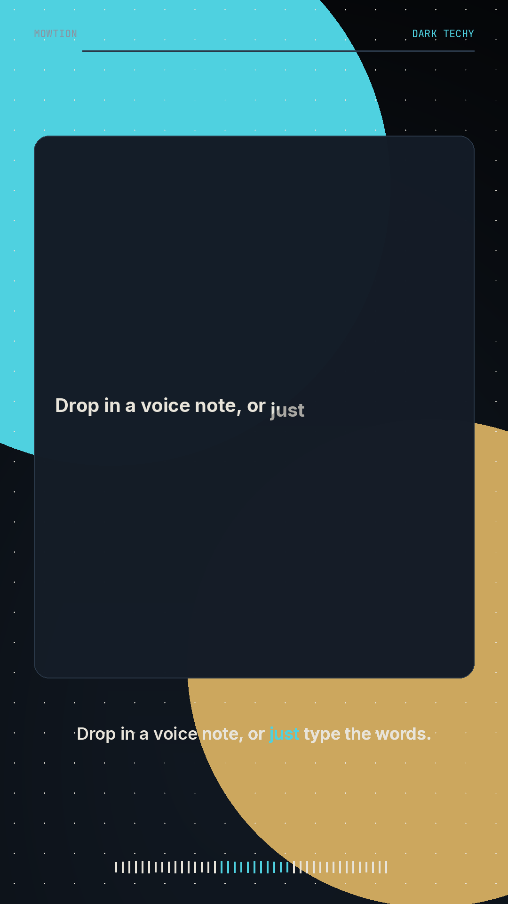
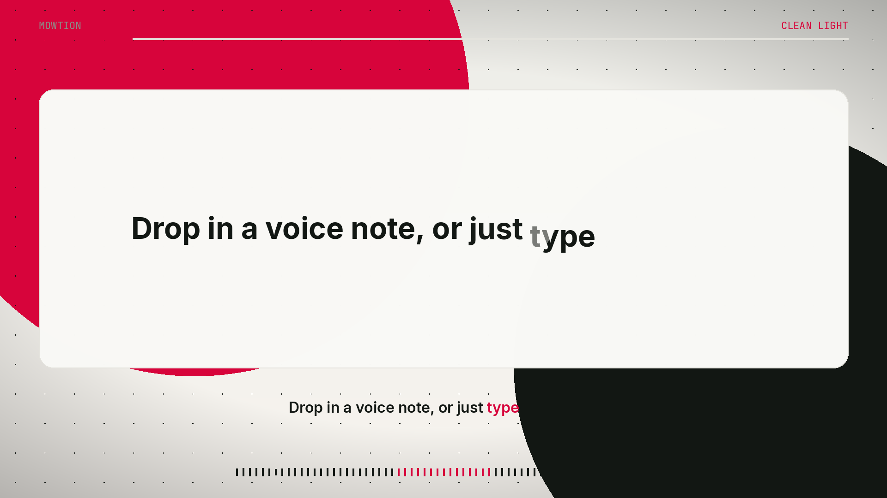

# mowtion

Turn a voice, or a script, into a finished motion-graphics video. Free, open source, and MIT licensed. It runs on your computer.





## Grok Bot

mowtion runs great with Grok Bot. Ask Grok to draft the script, the title, and the tags. Paste them into mowtion and render locally. The voice, the pictures, and the music stay on your machine.

## Quick start

You need Python 3.10+ and [ffmpeg](https://ffmpeg.org/download.html) on your PATH.

Windows: `winget install ffmpeg`

Mac: `brew install ffmpeg`

```bash
git clone https://github.com/krog4206941/mowtion.git
cd mowtion
python -m venv .venv
source .venv/bin/activate
pip install -e .
mowtion doctor
mowtion
```

`mowtion` opens a window in your browser (or a desktop window, if pywebview is installed). Type a script or drop a clip, pick a style, and press **Make video**.

The first render downloads the Kokoro voice model and the Whisper `small.en` model into `~/.cache/mowtion`. They are not in the git repo.

Render from the terminal:

```bash
mowtion render --script-file examples/script.txt --preset dark-techy --aspect 9:16 --out dark.mp4 --seo
mowtion render --input voice-note.wav --preset clean-light --aspect 16:9 --out wide.mp4
mowtion render --project dark.project.json
```

Each video gets a `project.json` next to it (`name.project.json`) with the script, the preset, the word timings, and the scenes. Re-rendering a script project speaks it again with the same settings.

### Styles

Dark Techy, Clean Light, Warm Editorial, Midnight Neon, Studio Blue.

Clean Light uses a `#EDEDE8` background, `#121713` text, and a `#D7043B` accent. Dark Techy is navy with teal and gold.

### What the video contains

- Word-level transcription with faster-whisper (`compute_type=float32`, after a 16 kHz WAV conversion). Dead air, filler words (`um`, `uh`, `you know`, …), and immediate repeats are removed.
- Kokoro TTS for typed scripts. The default voice is a 50/50 blend of `am_michael` and `am_onyx` at speed 1.03.
- Cards, bars, rings, line charts, kinetic type, and abstract motion. Springs settle. Strokes draw from the leading edge. The container appears before the words. Each graphic holds about 3–4 seconds, with a short breath before key lines. No flashes, no shakes.
- An original synth score, ducked under the voice, with a dip before key lines. The mix is mastered to -14 LUFS with true peak at or below -1 dBTP.
- Export is H.264 + AAC, 1080×1920 or 1920×1080, with faststart. `--seo` also writes a title, description, tags, thumbnail, and cover.

## Examples

Short renders are in `examples/` (together under 15 MB):

- `examples/dark-techy-9x16.mp4` — Dark Techy, vertical
- `examples/clean-light-16x9.mp4` — Clean Light, widescreen

The script is `examples/script.txt`.

## Build from source

```bash
pip install -e .
python -m unittest discover -s tests -v
```

Desktop installers are built by GitHub Actions when a version tag is pushed (`v0.1.0`, and so on). The workflow file is `.github/workflows/release.yml`. It produces:

- Windows: `mowtion-setup.exe` (PyInstaller app folder wrapped with Inno Setup)
- Mac: `mowtion-macos.dmg`

Those files are attached to the GitHub Release for that tag. Download links on the landing page point at the latest release.

To build locally:

```bash
pip install -e . pyinstaller
pyinstaller packaging/mowtion.spec
```

On Windows, compile `packaging/mowtion.iss` with Inno Setup. On macOS, the spec emits `dist/mowtion.app`; wrap it with Disk Utility or `hdiutil`. A terminal window stays open while the packaged app is running. Close it to quit. ffmpeg still has to be installed on the machine. Voice and transcription models download on first use.

The landing page lives in `/site` and is ready for GitHub Pages (set the site source to the `/site` folder on `main`).

## Tests

```bash
python -m unittest discover -s tests -v
```

CI runs that on every pull request (`.github/workflows/ci.yml`). The tests cover cleanup, pacing, both frame sizes, music, mastering, faststart export, and the local UI. They do not download the voice or Whisper models.

## License

MIT. See `LICENSE` and `THIRD_PARTY_LICENSES.md` for fonts, models, and tools. Remotion is not used.
